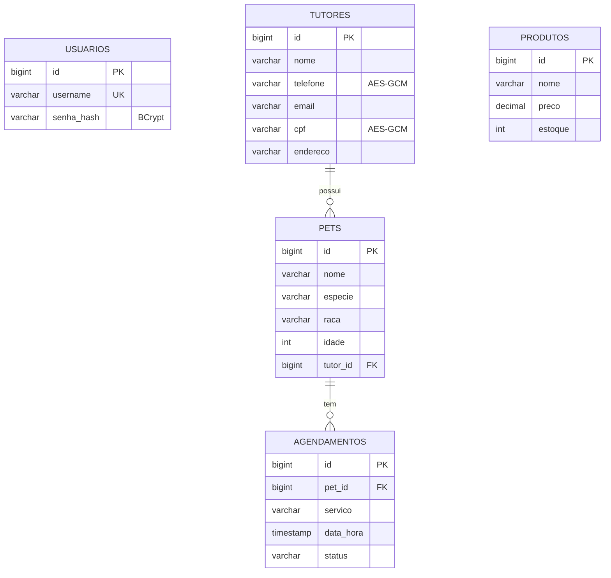

# 🐾 Sistema de Gestão para Pet Shop (Java + Spring Boot)

Atividade prática — **Técnico em Desenvolvimento de Sistemas**.
Aplicação web com **CRUD**, **banco de dados**, **senhas com hash (BCrypt)**, **CPF e telefone criptografados (AES-256-GCM)** e **sessão que expira após 30 s de inatividade** (validada no navegador **e** no servidor).

---

## 1. O que você precisa instalar

| Item | Versão | Como verificar |
|------|--------|----------------|
| **JDK** | 17 ou superior | `java -version` |
| **Maven** | 3.8+ | `mvn -version` |
| **VS Code** | qualquer recente | — |
| Extensão **Extension Pack for Java** | (vscjava.vscode-java-pack) | Aba Extensões do VS Code |
| Extensão **Spring Boot Extension Pack** (opcional) | (vmware.vscode-boot-dev-pack) | Aba Extensões |

> Se `mvn` não for reconhecido no terminal, instale o Maven (https://maven.apache.org/download.cgi) e adicione a pasta `bin` ao PATH, ou use a extensão *Maven for Java* (já vem no pack).
> É necessária **internet** na primeira execução (baixar dependências do Maven e o Bootstrap via CDN).

## 2. Como executar no VS Code

1. Abra o VS Code → **File → Open Folder…** → selecione a pasta `petshop` (a que contém o `pom.xml`).
2. Aguarde o VS Code importar o projeto (barra inferior: "Java: Ready").
3. Rode de **uma** destas formas:
   - **Terminal** (`Ctrl+'`): `mvn spring-boot:run`
   - **Botão Run:** abra `src/main/java/br/com/petshop/PetshopApplication.java` e clique em **▶ Run** acima do método `main`.
   - **F5** (usa o `.vscode/launch.json` incluído).
4. Quando aparecer `Started PetshopApplication`, abra **http://localhost:8080**.
5. No **primeiro acesso** você será levado a `/setup` para criar o **usuário administrador**. Depois, entre pelo login.

Para parar: `Ctrl+C` no terminal (ou ■ no VS Code).

## 3. Chave de criptografia (IMPORTANTE)

A chave AES **não está no código-fonte**. O sistema a procura nesta ordem:

1. **Variável de ambiente** `PETSHOP_KEY` (Base64 de 32 bytes);
2. Arquivo **`config/chave.key`** (já está no `.gitignore`).

Se nenhuma existir, **uma chave nova é gerada automaticamente** em `config/chave.key` no primeiro cadastro.

Para gerar uma chave você mesmo e usar variável de ambiente:

```bash
# Linux / macOS
export PETSHOP_KEY=$(openssl rand -base64 32)
# Windows PowerShell
$env:PETSHOP_KEY = [Convert]::ToBase64String((1..32 | % { Get-Random -Max 256 }) -as [byte[]])
```

> ⚠️ **Faça backup da chave.** Se ela for perdida, CPF e telefone já gravados ficam **irrecuperáveis**.
> Se trocar a chave com dados existentes, a leitura de tutores dará erro — apague a pasta `data/` para recomeçar.

## 4. Estrutura do projeto

```
petshop/
├── pom.xml                         dependências (Maven)
├── README.md / MANUAL.md
├── config/chave.key                (gerada; NÃO versionar)
├── data/petshop.mv.db              (banco H2 em arquivo; NÃO versionar)
├── .vscode/                        launch.json, settings, extensões
└── src/main
    ├── java/br/com/petshop
    │   ├── PetshopApplication.java   ponto de entrada
    │   ├── config/WebConfig.java     registra o interceptador de sessão
    │   ├── security/
    │   │   ├── SessaoInterceptor.java  valida expiração de 30 s NO SERVIDOR
    │   │   ├── CryptoUtil.java         AES-256-GCM + carga da chave
    │   │   └── CriptoConverter.java    criptografa campos automaticamente (JPA)
    │   ├── model/                    Usuario, Tutor, Pet, Produto, Agendamento
    │   ├── repository/               acesso ao banco (Spring Data JPA)
    │   ├── controller/               rotas: login, painel, tutores, pets, produtos, agendamentos
    │   └── util/Validador.java       CPF, telefone, e-mail
    └── resources
        ├── application.properties
        ├── static/js/sessao.js       temporizador de 30 s no navegador
        └── templates/                telas Thymeleaf + Bootstrap
```

## 5. Modelo de dados (diagrama entidade-relacionamento)



**Campos criptografados e justificativa:** `cpf` e `telefone` — são dados pessoais que identificam e permitem contatar o titular (LGPD). `senha` nunca é gravada: apenas o **hash BCrypt com sal**. `nome`, `e-mail` e `endereço` ficam em texto para permitir busca/ordenação (decisão de projeto — ver §8).

## 6. Como a segurança funciona

### Senhas
`BCryptPasswordEncoder` gera hash **com sal aleatório** (custo 10). O banco só guarda o hash; a verificação usa `matches()`. A mensagem de erro de login é genérica ("usuário ou senha inválidos"). A sessão é recriada no login (evita *session fixation*).

### Criptografia de CPF e telefone
`CriptoConverter` (JPA `AttributeConverter`) criptografa **automaticamente** ao gravar e descriptografa ao ler, com **AES-256-GCM** e IV aleatório de 12 bytes por valor (guardado junto: `Base64(IV + texto cifrado)`). Para comprovar, abra o arquivo do banco ou consulte `SELECT cpf, telefone FROM tutores` — só aparece Base64 ilegível.

### Sessão de 30 segundos (cliente + servidor)
| Camada | Onde | O que faz |
|--------|------|-----------|
| **Navegador** | `sessao.js` | Um único relógio compara `Date.now()` com o último evento (`click`, `keydown`, `mousemove`, `scroll`, `wheel`, `touchstart`, `input`). Aos **25 s** exibe aviso; aos **30 s** bloqueia a tela e redireciona a `/logout?motivo=inatividade` → login com mensagem. A cada atividade (máx. a cada 2 s) chama `/ping` para renovar a sessão no servidor. |
| **Servidor** | `SessaoInterceptor` | Em **toda requisição** compara o horário atual com o `ultimo` acesso gravado na sessão. Passou de 30 s → `invalidate()` + redireciona `/login?expirada`. Funciona mesmo que o JS seja desativado/alterado. |

Por usar `Date.now()` (e não contagem de ticks), o tempo continua correto mesmo se a aba ficar em segundo plano.

### Outras proteções
- **SQL Injection:** apenas JPA/Spring Data (consultas parametrizadas), sem SQL concatenado.
- **XSS:** Thymeleaf escapa todo `th:text`.
- Cookie de sessão `HttpOnly` e `SameSite=Strict`.
- Rota `/setup` só funciona enquanto **não existe** nenhum usuário.

## 7. Regras de negócio implementadas

- CRUD de **tutores**, **pets**, **produtos** e **agendamentos**, todos com busca por nome.
- Validação de **CPF** (dígitos verificadores), **telefone** (10/11 dígitos), **e-mail**, campos vazios, idade, preço e estoque ≥ 0.
- CPF duplicado é bloqueado.
- **Agendamento:** não permite **data no passado** (na criação) nem **dois agendamentos no mesmo horário** (cancelados não contam).
- Não é possível excluir **tutor com pets** nem **pet com agendamentos**.
- **Confirmação** antes de qualquer exclusão.
- **Painel:** agendamentos do dia, total de clientes, pets e produtos com estoque baixo (< 5).

## 8. Desafios e decisões de projeto (para o relatório)

1. **Reiniciar o temporizador sem duplicar:** um único `setInterval` verifica o tempo ocioso; os eventos apenas atualizam a variável `ultimo`.
2. **Sincronizar cliente e servidor:** `/ping` renova a sessão do servidor a cada atividade; o servidor tem a palavra final.
3. **Perda da chave:** dados irrecuperáveis → guardar backup da chave em local seguro, **separado** do backup do banco.
4. **Busca em campos criptografados:** `LIKE` não funciona em dados cifrados (IV aleatório). Decisão: **buscar só por nome** (não criptografado) e checar CPF duplicado **em memória** (viável para uma pet shop pequena). Alternativa em sistemas grandes: guardar um *hash HMAC* do CPF em coluna separada para busca exata.
5. **Segurança × usabilidade:** 30 s pode frustrar quem preenche formulário longo. Mitigações: aviso aos 25 s e `input` conta como atividade. Ao reautenticar, os dados digitados **não** são preservados (decisão consciente: dados na tela podem ser pessoais).
6. **LGPD:** CPF e contato são dados pessoais; coletamos só o necessário (**necessidade**) para a **finalidade** de atendimento, e os protegemos por criptografia e controle de acesso.

## 9. Roteiro de testes (Etapa 7)

| # | Teste | Resultado esperado |
|---|-------|--------------------|
| 1 | Abrir `/` sem login | Redireciona ao login |
| 2 | Criar admin em `/setup`, depois logar | Entra no painel |
| 3 | Senha errada | "Usuário ou senha inválidos." |
| 4 | Cadastrar tutor com CPF `111.111.111-11` | Erro "CPF inválido" ao lado do campo |
| 5 | Cadastrar tutor com CPF válido e pet vinculado | Salvo com mensagem de sucesso |
| 6 | Dois agendamentos no mesmo horário | Erro "Já existe um agendamento neste horário" |
| 7 | Agendar no passado | Erro de data |
| 8 | Ficar 25 s parado | Aviso amarelo com contagem |
| 9 | Ficar 30 s parado (sem recarregar) | Tela bloqueada → login com "sessão encerrada por inatividade" |
| 10 | Mover o mouse por 40 s seguidos | Sessão **não** expira |
| 11 | **Teste do servidor:** logar, desativar JS (DevTools → Settings → Disable JavaScript), esperar 35 s, clicar num link | Cai no login (`?expirada`) |
| 12 | Excluir tutor com pets | Bloqueado com mensagem |
| 13 | Ver o banco | Senha = hash `$2a$10$…`; CPF/telefone = Base64 ilegível (veja §10) |

### Testes automatizados

Execute `mvn test`. A suíte usa banco H2 em memória e cobre a renderização dos formulários, as mensagens de validação de tutores, pets, produtos e agendamentos e a expiração da sessão no servidor. Não altera o banco em arquivo usado pela aplicação.

## 10. Como inspecionar o banco (provar que não há dados legíveis)

Com o sistema **parado**, no terminal, na pasta do projeto (troque a versão do jar se necessário; o jar do H2 fica em `~/.m2/repository/com/h2database/h2/`):

```bash
java -cp ~/.m2/repository/com/h2database/h2/*/h2-*.jar org.h2.tools.Shell \
  -url "jdbc:h2:file:./data/petshop" -user sa -password ""
```
Depois: `SELECT username, senha_hash FROM usuarios;` e `SELECT cpf, telefone FROM tutores;`.

Alternativa: extensão **SQLTools** + driver H2 no VS Code.

> **SQLCipher:** o enunciado cita SQLCipher como opção para cifrar o arquivo inteiro. Aqui optamos por H2 + criptografia **por campo** (AES-GCM), que atende ao requisito e não exige binários nativos.

## 11. Problemas comuns

| Sintoma | Solução |
|---------|---------|
| `mvn não é reconhecido` | Instale o Maven e reinicie o VS Code/terminal |
| `release version 17 not supported` | Instale JDK 17+ e aponte `JAVA_HOME` para ele |
| `Port 8080 was already in use` | Mude `server.port` em `application.properties` |
| Página sem estilo | Sem internet (Bootstrap vem de CDN) |
| `Falha ao descriptografar` | Chave diferente da usada ao gravar → restaure a chave original ou apague `data/` |
| Quero zerar tudo | Pare o sistema e apague a pasta `data/` |

## 12. Entregáveis

- ✅ Código-fonte (esta pasta ou o `.zip`)
- ✅ Banco criado automaticamente pelo JPA (`ddl-auto=update`); esquema no §5
- ✅ README (este arquivo) e `MANUAL.md`
- ✅ Diagrama ER (§5)
- 📝 **Relatório de 1 página** — escreva com: decisões de segurança (§6), dificuldades (§8) e o que você faria diferente.

## 13. Limitações / ideias de bônus

Não implementados: proteção CSRF, perfis (administrador/atendente), auditoria, exportação CSV/PDF e bloqueio por tentativas de login. O **aviso visual aos 25 s** e os **testes automatizados de regressão** já estão incluídos.
